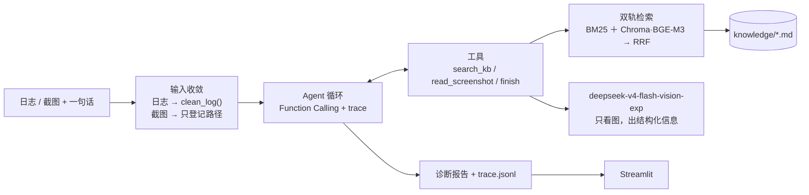

# UE5 智诊助手 · 技术方案

> **一句话**：贴一段 UE 日志或一张报错截图，Agent 自己规划要查什么，从知识库检索出同类案例，输出「是什么问题 / 根因 / 怎么修 / 该找谁 / 依据哪篇 case」。
> **五个特性**：Streamlit Web UI · DeepSeek 文本 + Vision 多模态 · BGE-M3 + ChromaDB 双轨知识库 · Function Calling 规划 · RAG 检索增强
> 日期：2026-10-13

---

## 0. 进度与分工（其余章节都是参考，不是待办清单）

**已落地并冒烟通过**（我写的通用件）：

| 文件 | 状态 |
|---|---|
| `uediag/types.py` | ✅ 数据契约 + `DEFAULTS` + `ensure_env()`（首次运行自动生成 `.env`） |
| `uediag/logparse.py` | ✅ `clean_log()`：流式扫描 / 窗口 / 栈帧归属 / 脱敏 |
| `uediag/kb.py` | ✅ 加载 md + BGE-M3 编码 + Chroma 入库检索 + BM25 + RRF |
| `uediag/llm.py` | ✅ `chat()` / `describe_image()` / token 与花费记账 |
| `uediag/trace.py` | ✅ `TraceRecorder` + 时间线打印 |
| `uediag/report.py` | ✅ 报告渲染（Markdown / JSON） |
| `uediag/cli.py` + `__main__.py` | ✅ `kb rebuild/check/search`、`log show`、`diagnose`（诊断分支待 `agent.py`） |
| `uediag/prompts/vision_extract.md` | ✅ 视觉抽取指令（只抽取不推理） |
| `knowledge/ue_errors/` | ✅ 5 条 case + 模板（照 `_template.md` 继续加） |
| `data/samples/*.log` | ✅ 3 个合成样本（崩溃 / 蓝图编译 / 链接错误） |

**剩下的只有两个文件，由你亲手写**：

| 文件 | 你要实现的东西 | 契约 |
|---|---|---|
| `uediag/tools.py` | 3 个工具 + JSON Schema：`search_kb`（调 `kb.search_kb`）/ `read_screenshot`（调 `llm.describe_image`）/ `finish`（参数 = `DiagnosisReport` 字段） | 见 §4 |
| `uediag/agent.py` | `run(log_path=None, image_path=None, note="") -> DiagnosisReport`：Function Calling 循环 + 引用校验 + 填 `trace_id` | 见 §5、§5.1 |

**当前可验收的东西**（不需要 `agent.py`）：

```bash
python -m uediag kb rebuild          # 知识库入库
python -m uediag kb search "开火就崩"  # 只跑检索
python -m uediag log show data/samples/crash_demo.log   # 只跑日志收敛
```

> **判断标准**：这一段之外的任何东西，都必须能说清「它对应哪个演示场景、怎么验证」——说不清就不做。

---

## 1. 五个特性 → 怎么实现 → 怎么验

| 特性 | 实现方式 | 一眼能验的东西 |
|---|---|---|
| **Function Calling 规划** | 自研 ~80 行循环：模型产出 `tool_calls` → 执行 → `role="tool"` 回传 → 直到 `finish` | trace 时间线 ≥3 步；检索 query 是模型自己写的 |
| **RAG 检索增强** | 知识库 case → 检索 top3 **全文**塞进上下文 | 报告里带 `[UE-ERR-0012]` 引用，能点回原文 |
| **双轨知识库**（BGE-M3 + ChromaDB） | 稠密轨：BGE-M3 编码进 Chroma（cosine）／稀疏轨：BM25 关键词打分／两路 **RRF 融合** | 口语化描述 与 错误码 两类 query 都能命中 |
| **DeepSeek 文本 + Vision** | 规划固定用 `deepseek-v4-flash`；截图交给 `deepseek-v4-flash-vision-exp` **只做结构化抽取** | 截图能读出错误码 / 资产路径 |
| **Streamlit Web UI** | 单文件：左侧上传、右侧 Tab 切换报告与 trace 时间线 | 浏览器现场演示 |

---

## 2. 架构



**分工原则**：规划模型永远只处理文本；视觉模型只做感知（不推理）；检索负责把「现象」映射到「已知案例」。

---

## 3. 数据契约

```python
# uediag/types.py
@dataclass
class Evidence:                       # clean_log() 的产物：把日志收敛成一小段确定性事实
    error_codes: list[str] = field(default_factory=list)   # Fatal error / LNK2019 / error C2065
    top_project_frame: str | None = None                   # 栈顶业务帧（引擎帧已剔除）
    key_lines: list[str] = field(default_factory=list)      # 报错行 + 前后上下文窗口

@dataclass
class RetrievedDoc:                   # 一次检索命中
    doc_id: str                       # UE-ERR-0012
    title: str
    score: float                      # RRF 融合分
    body: str                         # 全文（直接进上下文，不做 get_doc）
    path: str                         # .md 路径，供引用回链
    source_url: str | None = None

@dataclass
class DiagnosisReport:                # finish 的参数 = 最终产出
    category: str                     # crash/compile/build/cook/asset/perf/unknown
    confidence: str                   # high/medium/low
    summary: str                      # 一句话，给非技术同学看
    root_cause: str
    fix_steps: list[str]
    escalate_to: str | None           # 该找谁：程序组 / TA / 构建机
    evidence_refs: list[str]          # 引用的 doc_id，必须 ⊆ 本次检索集合
    cost_cny: float = 0.0
```

**为什么需要 `clean_log()`，而不是把日志原文直接喂进去**：

| 情况 | 直接喂原文 | 先收敛 |
|---|---|---|
| 用户粘贴几百行日志 | 可行 | 几乎不改动内容，顺手去掉时间戳噪音 |
| 真实项目 `Saved/Logs`（10–100 MB）／带完整 CallStack 的 crash log（几 MB） | **喂不进去**（1 MB ≈ 25 万 token，10 MB 就超过 1M 上下文） | 收敛成 ~40 行证据 |

它用约 25 行正则做三件事：抽错误码、**剔除引擎帧只看业务栈顶**（判断「这是不是你的代码」）、截取报错附近的窗口。

**两个容易写错的地方**：

1. **必须全文流式扫描，不能只读文件末尾**——崩溃栈在末尾，但**打包/烘焙失败的报错常常在开头**（UAT / LogCook）。逐行流式扫、内存里只留窗口：内存 O(窗口)、时间 O(文件)，这就是「10 MB ≤ 3 秒」的实现方式
2. **窗口之间要用 `---` 标记跳过的区间**——否则模型会以为上下文是连续的，可能脑补因果关系（「上一行在 Loading map，所以是加载时崩的」）。这是最便宜的防幻觉手段之一

> **和截图的对称性**：`read_screenshot` 是图像的收敛，`clean_log()` 是日志的收敛——两者都产出「一小段确定性文本」，再进同一个规划循环。只留其中一个，两种输入就不对称了。

---

## 4. 三个工具

| 工具 | 参数 | 返回 | 说明 |
|---|---|---|---|
| `search_kb` | `query`, `top_k=3` | `list[RetrievedDoc]`（**全文**） | 双轨检索入口；**query 由模型自己写** = 规划的直接证据 |
| `read_screenshot` | `image_ref`, `question` | 结构化文本（错误码 / 资产路径 / 报错原文 / `uncertainty`） | 内部单轮调视觉模型，**只抽取不推理** |
| `finish` | `report`（= `DiagnosisReport` 字段） | 终止信号 | 显式终止 + 结构化输出合一 |

**为什么只有三个**：`search_kb` 直接返回全文，所以不需要 `get_doc`；日志解析是**循环开始前的一次函数调用**（`clean_log()`，§3），不是工具——模型不需要「决定要不要解析日志」，那是确定性步骤。**工具越少，模型越不容易选错。**

---

## 5. Agent 规划循环

**规划的定义**：模型负责「做什么」，代码负责「边界」。

```python
def run(inp, cfg) -> DiagnosisReport:
    state = AgentState(evidence=clean_log(inp))          # 日志收敛：~25 行正则，不花 LLM 钱（§3）
    state.messages = [
        {"role": "system", "content": system_prompt(TOOL_HINTS)},
        {"role": "user",   "content": render(state.evidence, inp.user_note, inp.image_path)},
        # 只写「可用截图：xxx.png（要看请调 read_screenshot）」，图片不进 messages
    ]

    for step in range(cfg.max_steps):                    # 唯一的预算闸：最多 6 步
        resp = llm.chat(state.messages, model=cfg.model_text,
                        tools=SCHEMAS, tool_choice="auto")
        if not resp.tool_calls:                          # 模型直接说话 → 进收尾
            break
        state.messages.append(resp.as_assistant_message())        # ① 原样回传
        for call in resp.tool_calls:                              # ② 每个 call 都要回复
            result = invoke(call, state)                          # 内部 try/except，永不抛
            state.messages.append({"role": "tool", "tool_call_id": call.id,
                                   "content": truncate(result, MAX_OBSERVATION_CHARS)})
            trace.tool(call, result)
    else:
        state.messages.append({"role": "user", "content": "预算用尽，请基于现有证据出结论。"})

    final = llm.chat(state.messages, model=cfg.model_text, tools=[FINISH_SCHEMA],
                     tool_choice={"type": "function",
                                  "function": {"name": "finish"}})   # ③ 强制收尾
    report = validate_refs(parse(final), state.retrieved)   # 引用必须真实，否则降置信度
    return report
```

**三条必知细节**（不写清楚一定踩坑）：

1. **assistant 消息必须原样回传，且每个 `tool_call` 都要有一条 `role="tool"` 回复、`tool_call_id` 一一对应**——少一条或 id 对不上，接口直接报错
2. **收尾用 `tool_choice` 强制 `finish`**，参数就是报告结构 → 「显式终止」和「结构化输出」合成一个动作，不用解析自由文本
   - ⚠️ **前提是 `THINKING=disabled`**：思考模式下不支持指定函数的 `tool_choice`（实测 `400 Thinking mode does not support this tool_choice`）。若开了思考模式，收尾要改成「只传 `FINISH_SCHEMA` + 追加一条『请调用 finish』的 user 消息」
3. **预算耗尽不抛异常**，而是注入「基于现有证据出结论」+ 强制 `finish` → **永远有报告产出**，演示不会挂

**自愈**：参数不合 schema → 以 `role="tool"` 返回错误说明让它改；同一调用连续失败 2 次 → 代码拦截并提示换策略。

**为什么这是「规划」不是 `if-else`**：模型每轮看到「已有证据 + 工具清单」现场决定下一步——同一份日志，只要检索结果不同，它走的路径就会不同（可能直接 `finish`，也可能再查一次）。**trace 里能直接看到这种分叉。**

### 5.1 trace：规划的唯一可见证据

**它解决的问题**：Agent 是黑盒——只有输入和输出，你证明不了模型「决定」过什么。trace 把每一次决策和它的结果摊开，**让「规划」从一句主张变成一屏可读的事实**。

**记录什么**（每步一条，落盘 `runs/<id>/trace.jsonl`）：

| 字段 | 内容 |
|---|---|
| `action` / `args` | 模型调了哪个工具、参数是什么（**检索 query 是它自己写的**） |
| `observation` | 工具返回了什么（截断到 `MAX_OBSERVATION_CHARS`=1200 字符） |
| `ok` / `latency_ms` / `tokens` / `cost_cny` / `model` | 成功与否、耗时、token、花费、**哪个模型服务了这一步** |

**不记录什么**：模型的内心推理。Function Calling 下模型未必给出「理由文本」——**trace 只记录「它做了什么 + 看到了什么」，这才是可验证的部分**，不假装还原它的思考过程。

```
[0]             3ms   clean_log   error_codes=[EXCEPTION_ACCESS_VIOLATION]  栈顶业务帧=UMyTank::OnFire
[1] flash    2140ms   → search_kb("EXCEPTION_ACCESS_VIOLATION UMyTank::OnFire 开火崩溃")
                      ← 命中 3 条  UE-ERR-0012(0.91) / UE-ERR-0003(0.55) / UE-ERR-0007(0.41)
[2] vision   2650ms   → read_screenshot("shot.png", "截图里报的什么错")
                      ← Fatal error … /Game/Blueprints/BP_Tank
[3] flash    1200ms   → finish     crash / high / 引用 [UE-ERR-0012]
────────────────────────────────────────────────────────────────────────
5 步 · 7.9 秒 · 0.014 元
```

**三种用法**：

1. **演示**：Streamlit 右栏滚时间线，一屏跑完——**比讲代码有说服力**
2. **调试**：选错工具、query 写得烂、检索没命中，一眼看出是哪一步的问题（prompt 问题还是工具返回问题）
3. **冒烟测试断言**：`≥3 步`、`至少调用一次 search_kb`、`无伪造引用` 都能直接从 `trace.jsonl` 校验——不靠人眼

---

## 6. 双轨知识库（RAG）

### 6.1 case 格式（一条 case = 一个检索单元，不切碎）

```markdown
---
id: UE-ERR-0012
title: 角色开火时崩溃 EXCEPTION_ACCESS_VIOLATION
category: crash
keywords: [开火, 崩溃, 空指针, OnFire, 武器]
error_codes: ["EXCEPTION_ACCESS_VIOLATION"]
source_url: https://dev.epicgames.com/...
---
## 症状
## 常见根因（按概率排序）
## 排查步骤
## 修复方案
## 容易误判的情况
```

### 6.2 入库（喂什么文本决定召回质量）

```python
col = chromadb.PersistentClient(path=cfg("CHROMA_PATH")).get_or_create_collection(
        "ue_errors", metadata={"hnsw:space": "cosine"})
col.upsert(ids=[c.id for c in cases],
           embeddings=embedder.encode([c.embed_text for c in cases]),
           documents=[c.body for c in cases],              # 全文，检索到就直接返回
           metadatas=[{"category": c.category,
                       "error_codes": "|".join(c.error_codes)} for c in cases])
```

`embed_text` **不是全文**，而是 **`标题 + 关键词 + 错误码 + 症状首段`**：

1. 标题和关键词是人工提炼的高密度信号，密度远高于正文里散落的词
2. **错误码必须显式写进去**：纯向量对 `LNK2019` 这类符号区分度偏弱，写进被编码的文本才能让「查询带错误码」和「case 带错误码」的向量真正靠近
3. **`symptom` 要写成用户会说的那种人话**（「一进关卡就崩」），向量才抓得住口语化提问

### 6.3 检索（双轨 + RRF）

```python
def search_kb(query, top_k=3):
    dense  = col.query(query_embeddings=embedder.encode([query]), n_results=10)  # 稠密轨
    sparse = bm25.search(query, top=10)                                          # 稀疏轨（手写 ~40 行）
    return [load_doc(i) for i in rrf([dense, sparse], k=cfg_int("RRF_K"))[:top_k]]
```

**为什么要双轨**：UE 报错的信号强度和词频无关——`LNK2019` 在全文只出现一次，但它是决定性证据；向量会把 `LNK2019` 和 `error C2065` 编码得很近，**可能排错**。反过来，用户只写「一进关卡就崩」时，BM25 几乎没有共同词可命中。**两路各补对方的短板。**

**RRF 用排名而不是分数**：`score = Σ 1/(k + rank_i)`，免去「BM25 分和余弦距离怎么加权」的调参地狱。

**手写 BM25 的三个要点**：

1. **分词决定成败**：英文/标识符按 `[A-Za-z][A-Za-z0-9_]{2,}` 切，并把 `UMyTank::OnFire` 拆成 `umytank` + `onfire`（**不拆的话用户搜 `OnFire` 匹配不到**）；中文用 **2-gram**（「空指针」→ 空指/指针），零依赖、不引 jieba
2. **把 front-matter 的 `keywords` / `error_codes` 也纳入打分文本**——BM25 因此天然对错误码敏感，**省掉一整套字段加权逻辑**
3. 20 篇文档**不需要倒排索引**，线性打分即可（倒排是 1 万篇以上才需要的东西）

> 实现优先级：**先让稠密轨跑通（M1 上半场），BM25 + RRF 作为增量补上**。如果 Day 1 时间紧，先交纯向量版本跑通 M1 的错误码类 query，再把 BM25 补进来——两步都能独立验收。

**三路检索的实测对比**（`RETRIEVER` 一个变量切换，8 条验收 query）：

| 模式 | M1 验收 | 冷启动 | 每次 query 编码 | 说明 |
|---|---|---|---|---|
| `bm25` | 8/8 | **0.1 秒** | 0 | 不加载模型、不访问向量库，完全离线 |
| `vector` | 8/8 | 8.6 秒 | ~0.2 秒（CPU） | 模型只加载一次，之后每次很便宜 |
| `hybrid` | 8/8 | 8.6 秒 | ~0.2 秒 | 默认 |

三者打平是因为**写 KB 时把口语化说法也放进了 `keywords`**。真正拉开差距的是「用户说法没写进词库」时：

| 未入库的说法 | `bm25` | `hybrid` |
|---|---|---|
| 编译时提示找不到那个函数（期望 C2065） | UE-ERR-0001 ❌ 判成链接错误 | **UE-ERR-0005 ✅** |

> 这条对比就是「为什么不能只做关键词检索」的实证。**演示时可以先用 `bm25` 跑通全流程**（省掉每次重启命令行的 8.5 秒），正式演示再切 `hybrid`。

### 6.4 防幻觉（5 行代码，不能省）

- 报告里的 `evidence_refs` **必须 ⊆ 本次检索到的 doc_id 集合**；不实的直接剔除
- 剔除后引用为空 → **置信度强制降为 `low`**，并写明「知识库未覆盖，建议升级给程序同学」
- **宁可说不知道，也不编修复步骤**——这是排障工具的生命线

---

## 7. 截图链路（Vision 只做感知）

```
用户给截图 → 规划模型调 read_screenshot(path, question)
           → 工具内部单轮调 deepseek-v4-flash-vision-exp（messages 只有一条 user = 指令 + 图片）
           → 返回结构化文本：报错原文 / 错误码 / 资产路径 / uncertainty
           → 以 role="tool" 回传给规划模型，继续诊断
```

**抽取指令的三条铁律**：

1. **只抽取，不诊断**——不给根因、不给修复建议、不猜测。视觉模型一旦猜根因，就会产出没有知识库依据的结论，直接破坏防幻觉
2. **看不清就说看不清**——写进 `uncertainty`，**绝不填空**（它会变成给用户的追问，而不是编造的答案）
3. 严格按字段输出，缺的留空

**图片不进主循环**，所以不需要处理「图片只能出现在 user 消息」这类协议约束，也不需要跨轮图片状态机。想再看一眼？换个 `question` 再调一次即可。

---

## 8. 目录结构

```
UE5-Smart-Diagnose-Agent/
├─ README.md                  # 5 分钟跑起来
├─ ARCHITECTURE.md            # 本文件
├─ requirements.txt           # 依赖清单
├─ .gitignore                 # 忽略 .env / .chroma / runs / data/private
├─ .env                       # **首次运行自动生成**；密钥就地填（不进仓库）
├─ uediag/
│  ├─ __main__.py             # 让 `python -m uediag` 生效
│  ├─ types.py                # 数据契约 + DEFAULTS + ensure_env() + cfg()
│  ├─ logparse.py             # clean_log()：流式扫描 / 窗口 / 栈帧归属 / 脱敏
│  ├─ kb.py                   # 知识库：加载 md + BGE-M3 编码 + Chroma + BM25 + RRF
│  ├─ llm.py                  # 模型客户端：chat / describe_image / 记账
│  ├─ trace.py                # TraceRecorder + 时间线打印
│  ├─ report.py               # 报告渲染（Markdown / JSON）
│  ├─ cli.py                  # 参数解析 / 调 run() / 打印（**不含业务逻辑**）
│  ├─ prompts/
│  │  └─ vision_extract.md    # 视觉抽取指令（只抽取不推理）
│  ├─ tools.py                # ★ 你写：3 个工具 + schema
│  ├─ agent.py                # ★ 你写：Function Calling 循环 + 引用校验 + 填 trace_id
│  ├─ web.py                  # Streamlit Web UI（streamlit run uediag/web.py）
│  └─ fetch_model.py          # 从魔搭拉 BGE-M3 权重（python -m uediag.fetch_model）
├─ knowledge/
│  ├─ ue_errors/*.md          # 5 条已就绪 + _template.md（照模板继续加）
│  └─ redact.txt              # 脱敏规则（可选，一行 `正则 => 替换`）
├─ data/
│  ├─ samples/*.log           # 3 个合成样本（崩溃 / 蓝图编译 / 链接错误）
│  └─ private/                # 真实大日志（gitignore，体积+保密）
├─ models/                    # 本地权重（gitignore）
└─ runs/                      # trace 输出（gitignore）
```

**命令行**（`kb` 这层分组是为了给 `rebuild` / `check` 留位置）：

| 命令 | 作用 |
|---|---|
| `python -m uediag kb rebuild [--check]` | 知识库 → BGE-M3 → Chroma 入库（幂等）；`--check` 校验「文件数 = 文档数」 |
| `python -m uediag kb search "LNK2019"` | **只跑检索，不调 LLM、不花钱**；打印每条的 BM25 排名 / 向量排名 / RRF 分——用来单独验检索、调 `RRF_K`/`TOP_K` |
| `python -m uediag diagnose --log x.log [--image y.png] [--print-trace]` | 完整链路：`clean_log` → Agent 循环 → 报告 + `runs/<trace_id>.jsonl` |

**配置原则：`.env` 由程序自己生成，代码里有同名默认值，`.env` 不进仓库。**

- **首次运行自动创建 `.env`**（从 `types.py` 的 `DEFAULTS` 写出），打印「已生成 .env，请填入 OPENAI_API_KEY」
- `.env` 已存在则**原样保留**，绝不覆盖用户的密钥
- 参数都有代码内置默认值 → `.env` 缺项也能跑；**只有 `OPENAI_API_KEY` 必填**（缺了直接给出明确提示，而不是等到 401）
- 用 `python-dotenv` 读取（依赖清单里已有）
- **不再有 `.env.example`**：程序生成的那份就是模板

```python
# uediag/types.py —— 默认值 + 首次运行自动落盘
DEFAULTS = {
    "OPENAI_API_KEY": "",
    "OPENAI_API_URL": "https://api.deepseek.com",
    "MODEL_TEXT": "deepseek-v4-flash",                  # 规划 / Function Calling / 报告
    "MODEL_VISION": "deepseek-v4-flash-vision-exp",     # 只读图出结构化信息
    "MAX_STEPS": "6",
    "MAX_OBSERVATION_CHARS": "1200",
    "TOP_K": "3", "RRF_K": "60", "RETRIEVER": "hybrid",   # hybrid | vector | bm25
    "CHROMA_PATH": "./.chroma", "KNOWLEDGE_DIR": "./knowledge/ue_errors",
    "EMBED_BACKEND": "local", "EMBED_MODEL": "./models/bge-m3",
    "TRACE_DIR": "./runs", "PRINT_TRACE": "false",
}

def ensure_env(path=".env"):
    if not os.path.exists(path):                      # 只在缺失时生成
        open(path, "w", encoding="utf-8").write(
            "# 本文件由程序自动生成，唯一必填：OPENAI_API_KEY\n"
            + "\n".join(f"{k}={v}" for k, v in DEFAULTS.items()) + "\n")
        print(f"已生成 {path}，请填入 OPENAI_API_KEY 后重新运行")
    load_dotenv(path)                                  # python-dotenv
    if not os.environ.get("OPENAI_API_KEY"):
        raise SystemExit("请在 .env 里填入 OPENAI_API_KEY")
```

`cli.py` 和 `web.py` **第一行都调 `ensure_env()`**，所以两种入口都能自举。

> 真实大日志（≥10 MB、含项目信息）放 **`data/private/`**，该目录已被 `.gitignore` 忽略——**体积和保密两件事一起解决**。

**依赖（见 `requirements.txt`）**：`streamlit`（UI）· `openai`（官方 SDK，`base_url` 指向 DeepSeek，省掉手写 HTTP）· `chromadb` + `sentence-transformers`（BGE-M3 本地推理，`SentenceTransformer("BAAI/bge-m3")` 即可）· `python-dotenv`（读 `.env`）· `pillow`（截图尺寸检查）。**BM25 与 RRF 手写，不引检索库。**

> **唯一待决：`langchain` / `langchain-community` / `langchain-openai`。**
> 实测在 Python 3.14 上装这三个会**顺带拖进 120+ 个传递依赖**（含 `langgraph`、`kubernetes`、`grpc`、`pandas`、`scikit-learn`…）。核心循环自己写才讲得清楚「规划」，所以建议不装；如果你的目标是证明「会用生态」，那装也行——但要知道**规划会变成框架内部行为**（§5），调试和排错时都不容易看清。见 §11。

---

## 9. 里程碑（3 步，每步都能独立演示）

| # | 交付 | 验收 |
|---|---|---|
| **M1** | 知识库 + 双轨检索 | `python -m uediag kb search "LNK2019"` 返回正确的 case；错误码类与口语化类 query 各测 3 条 |
| **M2** | Agent 循环 + 引用校验 + trace | `python -m uediag diagnose --log data/crash.log` 出报告；trace ≥3 步、模型自主调用 ≥2 次工具、伪造引用被剔除；**再用一份 ≥10 MB 的真实日志验证 `clean_log()`**：≤3 秒收敛、输出 ≤2000 行、错误码与栈顶业务帧抽取正确 |
| **M3** | 截图链路 + Streamlit | 浏览器上传截图与日志都能演示；截图能读出错误码 |

> **分工边界（重要）**：`uediag/agent.py` 与 `uediag/tools.py` **由你亲手写**（这是 Demo 的核心）；其余通用件（types / logparse / kb / llm / trace / report / cli / prompts / knowledge / samples）已由我落地并冒烟通过。`uediag/web.py`（Web UI）**已落地**。
> **接缝**：`run(log_path=None, image_path=None, note="") -> DiagnosisReport`；UI 右栏时间线读 `{TRACE_DIR}/{report.trace_id}.jsonl`——**所以 `DiagnosisReport` 需要一个 `trace_id` 字段**（否则 UI 拿不到轨迹）。

> **3 天排期**：**Day 1 = M1**（环境 + 知识库 + 双轨检索）→ **Day 2 = M2**（`clean_log` + 工具 + Agent 循环 + trace）→ **Day 3 上午 = M3 截图链路，下午 = Web UI + 冒烟测试 + 演示彩排**。
> ⚠️ **最长的一根杆是 BGE-M3 权重（约 2.1 GB）**——一开工就后台启动，别等写到检索那一步才下。
> **权重走魔搭**：用 `python -m uediag.fetch_model` 从魔搭（ModelScope）拉到 `models/bge-m3/`（支持断点续传），`.env` 的 `EMBED_MODEL` 指向它即可离线加载。

---

## 10. 冒烟测试（不做评测框架，5 条样本够了）

**样本数据**（`data/samples/`）：

- **1 份真实大日志**（≥10 MB，从自己项目 `Saved/Logs` 拷）——用来证明 `clean_log()` 不是摆设
- 3~5 段小日志片段（错误码类 / 口语化描述类 各占一些）
- 1~2 张报错截图

> ⚠️ **真实日志必须脱敏**：删掉项目名、公司名、内部资产路径、人名/账号。Demo 可能被投屏或发给别人看，这一步不能省——`clean_log()` 里可以顺手加一个「敏感词替换」开关。

```yaml
- id: CASE-003
  input: data/samples/blueprint_compile.log
  expect:
    category: compile
    must_cite: [UE-ERR-0007]        # 期望引用到的 case
    must_not: ["重装引擎"]           # 反面清单：出现即扣分
```

跑一次输出四个数字即可：**分类正确数 / 引用命中数 / 违规建议数 / 平均步数**。这张表就是「我做的不是玩具」的证据。

---

## 11. 决策

**已冻结**：原生 Function Calling 做规划 · 视觉模型只做感知 · 规划固定 `deepseek-v4-flash`、视觉固定 `deepseek-v4-flash-vision-exp` · **双轨检索（BM25 + Chroma/BGE-M3，RRF 融合）** · 无引用不给答案 · 6 类分类 + `unknown` 兜底 · 3 个工具 · `.env` 不进仓库（自动生成）。

**待确认**（不影响开工）：

| # | 问题 | 建议 |
|---|---|---|
| 1 | **`langchain*` 要不要留在 `requirements.txt` 里** | **去掉**：核心循环 80 行自己写才讲得清「规划」；装了它还会拖进 120+ 个传递依赖（含 `langgraph`） |
| 2 | BGE-M3 跑法：本地推理（`EMBED_BACKEND=local`，离线、首次下载权重）／ embedding API（`api`，需在 `.env` 多一条 `EMBED_API_KEY`） | **本地**：Demo 要能断网演 |
| 3 | 知识库做 8 条还是 20 条 | 8 条跑通，20 条演示效果更好 |
| 4 | 是否需要 UE5 编辑器插件形态的代码 | 只留设计思路（本机无 UE5，无法编译验证） |

---

## 附：五个特性的设计要点

1. **规划**：模型每轮看到「已有证据 + 工具清单」，自己决定调哪个工具、query 怎么写、信息够不够、什么时候 `finish`；代码只给预算（最多 6 步）和把关（引用校验）。**规划是模型现场决策的，不是 `if-else` 写死的。**
2. **工具调用**：用原生 Function Calling，不是让模型输出 JSON 再正则解析——省掉 markdown 围栏、非法 JSON、`"true"` 当布尔这些坑，还白拿并行调用和参数 schema 约束。
3. **RAG**：`search_kb` 的 query 由模型自己写，所以「检索什么」也是规划的一部分；检索结果直接返回全文，省掉一次 `get_doc` 往返。
4. **RAG 是双轨，且质量在入库时决定**：`embed_text` 用「标题+关键词+错误码+症状」而非全文——错误码必须显式写进去，否则查询带 `LNK2019` 时向量抓不住。检索时 BM25 补符号精确匹配、向量补口语化描述，**RRF 用排名融合，免调两路分数量纲**。
5. **防幻觉**：报告引用必须 ⊆ 本次检索集合，不实引用剔除后置信度自动降为 `low`，并明说「知识库未覆盖，建议找程序员」——**宁可说不知道，也不编答案**。
